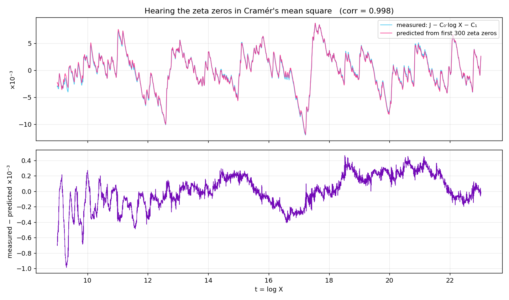

# 🌉 Cramér Bridge — Exploration 38

*October 14, 2026 — the first math night back.*

Computes the Báez-Duarte distance d²(N) for the Möbius log-cutoff witness
**directly in the time domain**. It needs no Gram matrix and no cotangent sums,
and the work is O(U log N).

## The bridge

Substituting u = 1/x, the BD residual is piecewise linear on unit intervals.
For u ≤ N, the classical identity Σ_{k|m} μ(k) log k = −Λ(m) gives **exactly**:

```
F(u) = (u − ψ(u)) / log N  −  ε·u,        ε = A + 1/log N  (PNT-small)
```

So below the cutoff, **the Báez-Duarte residual is the Chebyshev error**, and

```
d²·log N  ≈  (1/log N) · ∫₁ᴺ ((ψ(u) − u)/u)² du      (Cramér's mean square)
```

This accounts for about 98.8% of d² at every N tested.

## Validation (vs Wall.lean HPDF table)

| N | vᵀGv here | vᵀGv (Wall.lean) |
|---|---|---|
| 720 | 0.58687 | 0.587 |
| 55,440 | 0.73671 | 0.737 |

margin·log N at 55,440: **2.87592** (paper: 2.876). N = 10⁷ runs in about 13 s on a laptop.

## Results (U = 32N)

| N | d²·log N | cramér/log N | vᵀGv |
|---|---|---|---|
| 10⁵ | 0.2676 | 0.2645 | 0.7493 |
| 10⁶ | 0.2307 | 0.2280 | 0.7884 |
| 10⁷ | 0.2044 | 0.2020 | 0.8170 |

Linear fit in 1/log N over 14 points (N = 720 … 10⁷):

- d²·log N → **C₀ = 0.0459** (theory 2+γ−ln 4π = 0.04619, Bettin–Conrey–Farmer / Burnol)
- next-order coefficient **C₁ ≈ 2.55** (Cramér's constant term; ∫₁² 1 du = 1 of it)
- implied margin constant **D → 3.1085** (theory γ + ln 4π = ln π − ψ(½) = 3.1082)

## Reading

The Wall (vᵀGv ≤ 1) is approximately
**∫₁ᴺ ((ψ(u) − u)/u)² du ≤ 2(1+γ)·log N**.
A classical fact says this integral is O(log N) **if and only if** RH holds.
So the Wall is RH in Cramér's form with an explicit constant: allowed about 3.15, true value about 0.046.
This is a reformulation, not a proof route by itself.

## Listening: the zeros in the wiggles

`src/bin/listen.rs` computes Cramér's mean square exactly (piecewise on unit intervals):

```text
J(X) = ∫₁^X ((ψ(u) − u)/u)² du
```

By the bridge, d²(N)·log²N ≈ J(N), so the wiggles of J are the wiggles of the Báez-Duarte distance.
Under RH the explicit formula predicts:

```text
J(X) = C₀·log X + C₁ + Σ_{ρ≠ρ'} X^{i(γ−γ')} / (i(γ−γ')·ρ·ρ̄') + o(1)
```

The oscillations sit at the zero **differences** γⱼ − γₖ.
`listen_analysis.py` fits C₀ and C₁, then compares the residual with that sum.

| X_max | zeros | C₀ fit | C₁ fit | corr(resid, prediction) | rms after subtraction |
|---|---|---|---|---|---|
| 10⁸ | 30 | 0.046211 | 2.512 | 0.977 | n/a |
| 10⁸ | 300 | 0.046211 | 2.512 | 0.9986 | 1.96e-4 |
| 10¹⁰ | 300 | 0.046220 | 2.5120 | **0.9980** | 2.17e-4 |

- Theory: C₀ = 2 + γ − ln 4π = 0.046191.
- Null test: replacing the zeros with fake ones gives |corr| ≤ 0.077.
- The X = 10¹⁰ run takes about 150 s on a laptop.
- Zeros: `results/zeta_zeros_300.txt` (mpmath, 15 digits).



## Usage

```bash
cargo run --release -p cramer-bridge -- [U_FACTOR] [N ...]
CHECKPOINTS=1 cargo run --release -p cramer-bridge -- 64 55440   # U-convergence

# listening
cargo run --release -p cramer-bridge --bin listen -- 1e10 0.002 > results/listen_1e10.tsv
python3 listen_analysis.py results/listen_1e10.tsv 9.0 results/zeta_zeros_300.txt
```
